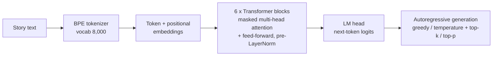
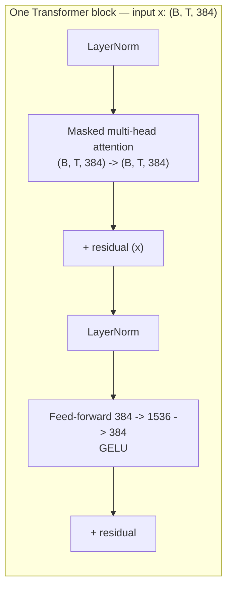

# Transformer from Scratch

[](https://huggingface.co/spaces/Skywalker67/transformer-from-scratch)
[](https://www.python.org/)
[](https://pytorch.org/)
[](https://github.com/tanishq-2004/transformer-from-scratch)

A decoder-only GPT-style Transformer built in PyTorch **from scratch**. It learns
to write TinyStories-style children's stories, one token at a time.

**Try it live:** https://huggingface.co/spaces/Skywalker67/transformer-from-scratch

## Project overview

This project implements a small language model the hard way: every component of
the Transformer is hand-coded in `src/model.py` — scaled dot-product attention,
multi-head attention, causal masking, positional embeddings, the feed-forward
network, residual connections and LayerNorm. There is no `nn.Transformer`, no
Hugging Face model, no Trainer. The model is trained from random initialisation
on TinyStories and evaluated on a held-out test split.

To be precise about what "from scratch" means here:

- **Hand-coded:** the GPT architecture itself — embeddings, attention, masking,
  the Transformer blocks, the language-model head, the training loop, the
  generation loop with KV cache, and the evaluation code.
- **Library code:** PyTorch (tensors, autograd, the AdamW optimiser), and the
  Hugging Face `tokenizers` library, which trains the BPE tokenizer. The
  tokenizer is library-based, not hand-written — the model is a GPT
  implemented from scratch with a library-based tokenizer, not a completely
  from-scratch NLP pipeline.

## Why this project exists

Most language-model projects import a pretrained model and fine-tune it. That
hides the part that matters: how a Transformer actually works. This project
exists to learn that part properly — to implement attention, masking and
training by hand, measure the results honestly, and test which design choices
actually matter through controlled ablation experiments. It is a learning
project and a small experimental model, not a production system (see
[Small model vs production LLMs](#small-model-vs-production-llms)).

## At a glance

| | |
|---|---|
| Architecture | Decoder-only Transformer (GPT-style), hand-coded in PyTorch |
| Parameters | **13,792,128** |
| Layers / heads / hidden | 6 layers, 6 heads, 384 hidden, context 256 |
| Tokenizer | BPE, trained on TinyStories with the `tokenizers` library, vocab 8,000 |
| Dataset | TinyStories — 200,000-story subset (full split: 2,119,719 train / 21,990 val) |
| Training | 8,000 steps, 6,071 s (~101 min) on a Colab T4 GPU |
| Final train loss | **1.7893** |
| Final val loss | **1.8295** |
| Final val perplexity | **6.23** |
| Test perplexity | **6.31** (held-out test split, 2,000 stories) |

## How it works





## What is hand-coded, what is library code

Hand-coded in this repo:

- Token embeddings and positional embeddings (learned and sinusoidal)
- Scaled dot-product attention, including the causal mask
- Multi-head self-attention with a KV cache for generation
- Feed-forward networks, residual connections, pre-LayerNorm
- The decoder-only Transformer stack and the tied LM head
- Cross-entropy training on next-token prediction (PyTorch autograd for
  backpropagation)
- Training on a real text corpus, autoregressive text generation
  (greedy, temperature, top-k, top-p)
- Evaluation: loss, perplexity, latency, memory, generation samples

Taken from libraries:

- PyTorch tensors, autograd and `AdamW`
- The Hugging Face `tokenizers` library for BPE tokenizer training
  (`Tokenizer(BPE)` + byte-level pre-tokenizer + `BpeTrainer`)
- The `datasets` library for loading TinyStories

## Transformer architecture

The model is a decoder-only Transformer: a stack of 6 identical blocks, each
with masked multi-head self-attention followed by a feed-forward network, both
wrapped in pre-LayerNorm residual connections. The configuration
(`configs/small.yaml`) is: vocabulary 8,000, context length 256, 6 layers,
6 heads, hidden size 384, dropout 0.1, learned positional embeddings.
No bias terms are used in any `Linear` or `LayerNorm`, as in nanoGPT.

Tensor shapes use `B` = batch size (64 in training), `T` = sequence length
(≤ 256), `C` = hidden size (384), `H` = number of heads (6),
`D` = head dimension = `C / H` = 64, `V` = vocabulary size (8,000).

### Input embeddings

A token id sequence `idx` of shape `(B, T)` is embedded in two parts, which
are added together and dropped out (dropout 0.1 during training):

- **Token embedding:** a learned table of shape `(V, C)` = `(8000, 384)`,
  so `tok_emb` has shape `(B, T, 384)`.
- **Positional embedding:** a learned table of shape `(block_size, C)` =
  `(256, 384)`, so `pos_emb` has shape `(B, T, 384)`.

`x = dropout(tok_emb + pos_emb)`, shape `(B, T, 384)`. During generation with
a KV cache, positions are offset by the cached length, so a newly generated
token gets its true position rather than position 0.

### Self-attention: the mathematics

Self-attention lets every position look at every earlier position and decide
how much each one matters for predicting the next token. For an input
`x` of shape `(B, T, C)`:

1. **Project to queries, keys and values.** One linear layer maps
   `(B, T, 384)` to `(B, T, 1152)`, which is split into three
   `(B, T, 384)` tensors `Q`, `K`, `V`:

   `Q = xW_Q, K = xW_K, V = xW_V`, each `W` of shape `(384, 384)`.

2. **Score every pair.** For each query position `i` and key position `j`,
   the score is the dot product of the query and key vectors, scaled by
   `1 / sqrt(D)` where `D = 64` is the head dimension:

   `scores[i, j] = (q_i . k_j) / sqrt(64)`

   The scaling keeps the dot products in a range where softmax gradients do
   not vanish as the dimension grows. The full score tensor has shape
   `(B, H, T, T)`.

3. **Mask the future.** Before the softmax, every score with `j > i` is set
   to `-inf`, so a position can only attend to itself and earlier positions.
   This is the causal mask (see below).

4. **Softmax and weighted sum.** The masked scores are soft-maxed over the
   key dimension to give attention weights, and the output is the weighted
   sum of the value vectors:

   `Attention(Q, K, V) = softmax(QK^T / sqrt(D) + mask) V`

   The output has the same shape as the input, `(B, T, 384)`.

Attention is quadratic in sequence length: the `(B, H, T, T)` score tensor
grows with `T^2`, which is why the context length is capped at 256.

### Multi-head attention

Instead of one attention operation on the full 384 dimensions, the model runs
6 attention heads in parallel, each on a 64-dimensional slice:

- `Q`, `K`, `V` of shape `(B, T, 384)` are reshaped to
  `(B, 6, T, 64)` — one `(B, T, 64)` slice per head.
- Each head computes scaled dot-product attention independently, producing
  `(B, 6, T, 64)`.
- The heads are concatenated back to `(B, T, 384)` and passed through an
  output projection `W_O` of shape `(384, 384)`.

Splitting the heads costs no extra parameters: the QKV projection is a single
`384 -> 1152` linear layer and the output projection is `384 -> 384`,
regardless of the head count. That is why the 1-head ablation has exactly the
same parameter count (13,792,128) as the 6-head baseline — the heads only
change how the 384 dimensions are grouped. Each head can learn a different
relation (for example, one tracking the subject of a sentence, another
tracking the most recent verb), which is the point of the single-head vs
multi-head experiment.

### Causal masking

A language model must not see the future: when it predicts the token at
position `t+1`, it may only use tokens up to position `t`. The mask is a
lower-triangular matrix of shape `(256, 256)` — `1` on and below the diagonal,
`0` above it — registered as a buffer so it moves with the model to the GPU
but is not a trainable parameter. In the forward pass, scores where the mask
is `0` are filled with `-inf` *before* the softmax, so after the softmax
those positions get exactly zero weight.

During generation with a KV cache, the mask is sliced with an offset equal to
the cached length, so the `i`-th generated token attends to all cached tokens
plus itself, and nothing else. The causal property is verified by a unit check:
changing the token at position 10 leaves the logits at positions 0–9 exactly
unchanged (max difference 0.00e+00).

### Positional embeddings

Attention on its own has no sense of order — the same set of tokens in a
different order would give the same attention weights. Positional embeddings
fix that by adding a position-dependent vector to every token embedding.

- **Learned (default):** a trainable table of shape `(256, 384)`. The model
  learns what each position means during training. This is what the final
  model uses.
- **Sinusoidal:** a fixed table built from sines and cosines,
  `PE(pos, 2i) = sin(pos / 10000^(2i/384))`,
  `PE(pos, 2i+1) = cos(pos / 10000^(2i/384))`. It has no parameters, so the
  sinusoidal model has 98,304 fewer parameters (13,693,824) than the learned
  one. Different positions get different, smoothly varying vectors, and the
  pattern extends to positions beyond those seen in training.

The ablation comparing learned vs sinusoidal embeddings tests whether a
trainable table fits TinyStories better than the fixed formula. (It does, by
a wide margin — see the experiments table.)

### Feed-forward networks

After attention, each position is processed independently by a two-layer
feed-forward network:

`FFN(x) = W_2 ( GELU( W_1 x ) )`, with `W_1: (384, 1536)` and
`W_2: (1536, 384)`.

The inner dimension is `4 * C` = 1536. The GELU activation is used instead of
ReLU. A dropout layer follows the second projection. The FFN has no
interaction between positions — all the mixing between positions happens in
the attention layer; the FFN is where each position's representation is
transformed on its own. The FFN holds most of the model's parameters:
`2 * 384 * 1536 = 1,179,648` per block, about two thirds of a block's
1,770,240 parameters.

### Residual connections

Each sub-layer is wrapped in a residual connection: the sub-layer's output is
added back to its input.

`x = x + Attention(LayerNorm(x))`
`x = x + FFN(LayerNorm(x))`

Without residuals, gradients would have to flow through 6 blocks of
attention and feed-forward layers in series, and the signal would vanish.
With residuals, there is a direct path from the output back to the input of
every block, so the model trains at all at this depth. The residual stream
(the `(B, T, 384)` tensor `x`) is the model's working memory: attention reads
from it and writes back to it, and the FFN does the same.

### Layer normalization

Normalization is applied *before* each sub-layer (pre-LayerNorm), not after.
Each `LayerNorm` normalizes over the 384 hidden dimensions of each token
independently (mean 0, variance 1, then a learned per-dimension scale; no bias
term in this codebase). Pre-LayerNorm keeps the activations well-scaled at
every depth, which is what makes training stable without the learning-rate
warmup doing all the work. A final LayerNorm is applied after the last block,
before the LM head.

### Parameter count

| Component | Shape | Parameters |
|---|---|---|
| Token embedding (tied to LM head) | `(8000, 384)` | 3,072,000 |
| Positional embedding (learned) | `(256, 384)` | 98,304 |
| Per block: LayerNorms (×2) | `(384)` each | 768 |
| Per block: QKV projection | `(384, 1152)` | 442,368 |
| Per block: attention output projection | `(384, 384)` | 147,456 |
| Per block: FFN `384 -> 1536` | `(384, 1536)` | 589,824 |
| Per block: FFN `1536 -> 384` | `(1536, 384)` | 589,824 |
| Per block total | | 1,770,240 |
| 6 blocks | | 10,621,440 |
| Final LayerNorm | `(384)` | 384 |
| **Total** | | **13,792,128** |

The LM head is a `384 -> 8000` linear layer whose weight is *tied* to the
token embedding — it is the same tensor, not a second copy — which saves
3,072,000 parameters. Weights are initialised from `N(0, 0.02)`; the
residual output projections (`c_proj`) use a smaller scale,
`0.02 / sqrt(2 * n_layer)`, as in nanoGPT.

### BPE tokenizer

The tokenizer is byte-level BPE, trained with the Hugging Face `tokenizers`
library (`Tokenizer(BPE)` + byte-level pre-tokenizer + `BpeTrainer`) on the
TinyStories training subset. It is **library-based, not hand-coded** — the
hand-coded part of this project is the model, and the tokenizer section of the
resume says so.

- Vocabulary: 8,000 tokens, including 4 special tokens —
  `<pad>` (id 0), `<bos>`, `<eos>`, `<unk>`.
- Byte-level: no character is ever discarded. Any byte sequence can be
  represented, so the tokenizer handles any text, including text it has never
  seen.
- Encoding wraps a story as `<bos> ... <eos>` by default. Decoding skips
  special tokens.
- The trained tokenizer is saved as `checkpoints/tokenizer.json`
  (547,759 bytes) and is loaded by training, evaluation and serving alike,
  so every part of the pipeline tokenizes identically.

### Training objective

The model is trained to predict the next token. Each training batch is a set
of random `(block_size + 1)`-token windows cut from the tokenized corpus:

`x = tokens[i : i+256]`, `y = tokens[i+1 : i+257]`, both of shape `(64, 256)`.

The loss is cross-entropy between the model's logits and `y`, flattened over
batch and time — one classification over 8,000 classes per token position.
Perplexity is `exp(loss)`: a perplexity of 6.23 means the model is, on
average, as uncertain as if it were choosing uniformly among about 6 tokens.
Backpropagation is PyTorch autograd; the optimiser is AdamW with learning
rate 3e-4, minimum 3e-5, 500 warmup steps, cosine decay, betas (0.9, 0.95),
weight decay 0.1 applied only to matrices (tensors with dimension ≥ 2), and
gradient clipping at 1.0. On CUDA, the forward pass runs under bf16 autocast.

## Dataset

**Source:** [roneneldan/TinyStories](https://huggingface.co/datasets/roneneldan/TinyStories)
on Hugging Face — short synthetic children's stories generated by GPT-3.5 and
GPT-4 using a small vocabulary, described in Eldan & Li,
*TinyStories: How Small Can Language Models Be and Still Speak Coherent
English?* ([arXiv:2305.07759](https://arxiv.org/abs/2305.07759)).

**License:** CDLA-Sharing-1.0 (the dataset's licence on Hugging Face).
The code in this repository does not redistribute the dataset; it downloads it
from Hugging Face at training time.

| Split | Stories |
|---|---|
| Train (full) | 2,119,719 |
| Validation (full) | 21,990 |
| Train (this run) | 200,000 (seed-42 shuffle, then capped) |
| Validation (this run) | 2,000 |
| Ablations | 50,000 train stories each |

The full run encoded 44,213,166 training tokens. Stories are short (typically
around 200 tokens), written in simple English with a small vocabulary, which
is what makes a 13.8M-parameter model able to write coherent text at all.
The smoke test uses Tiny Shakespeare instead — about 1 MB of text downloaded
from Karpathy's char-rnn repository.

## Installation

```bash
git clone https://github.com/tanishq-2004/transformer-from-scratch.git
cd transformer-from-scratch
python -m venv .venv && source .venv/bin/activate
pip install -r requirements.txt
```

Requires Python 3.12 and: `torch>=2.4`, `tokenizers>=0.20`, `datasets>=2.20`,
`pyyaml>=6.0`, `numpy>=1.26`, `fastapi>=0.110`, `uvicorn>=0.29`. Training a
full run needs a GPU (the reference run used a Colab T4); the smoke test,
generation and evaluation all run on CPU.

## Dataset preparation

`src/data.py` loads TinyStories with the `datasets` library, shuffles with a
fixed seed (42) and caps the split, then encodes every story once into a
single flat int64 array (stories joined by `<eos>`), held in memory as a
NumPy array. Batches are random windows cut from that array, so training
never sees the same window twice in a row and there is no leakage between
train and validation — they are disjoint splits of the same dataset.

```python
from src.data import load_tinystories_texts, encode_texts_to_array, get_batch

train_texts = load_tinystories_texts("train", 200_000)
train_data = encode_texts_to_array(encode_fn, train_texts)  # flat int64 array
x, y = get_batch(train_data, batch_size=64, block_size=256, device="cuda")
# x: (64, 256), y: (64, 256) — y is x shifted by one token
```

## Tokenizer training

If `checkpoints/tokenizer.json` is missing, `src/train.py` trains the BPE
tokenizer automatically on the training texts before training starts. It can
also be trained standalone:

```python
from src.tokenizer import train_bpe_tokenizer
tokenizer = train_bpe_tokenizer(texts, vocab_size=8000,
                                save_path="checkpoints/tokenizer.json")
```

## Model training

```bash
# Full run (GPU recommended — 8,000 steps, ~101 min on a Colab T4)
python -m src.train --config configs/small.yaml

# Resume from a checkpoint
python -m src.train --config configs/small.yaml --resume checkpoints/ckpt_step_1000.pt

# CPU smoke test (2 layers, Tiny Shakespeare, 50 steps, ~1 minute)
python -m src.train --config configs/smoke.yaml
```

The training loop (`src/train.py`) evaluates train and validation loss every
500 steps (mean over 50 random batches) and writes `logs/train_log.csv` and
`logs/train_log.json` with step, train loss, val loss, val perplexity,
learning rate and elapsed seconds. Checkpoints are saved every 1,000 steps
(`checkpoints/ckpt_step_1000.pt` … `ckpt_step_8000.pt`, 160 MB each,
including optimiser state) and can be resumed with `--resume`, which restores
the model, the optimiser and the step count.

The full run processed 131,072,000 tokens (8,000 steps × 64 × 256) — about
2.96 epochs over the 44.2M-token training set — at roughly 21,590 tokens/sec.

## Text generation

```bash
python -m src.generate --checkpoint checkpoints/ckpt_step_8000.pt \
  --tokenizer checkpoints/tokenizer.json \
  --prompt "Once upon a time" --max_new_tokens 50 --temperature 0.8 --top_k 50
```

Generation is autoregressive: the model predicts one token, appends it, and
feeds the extended sequence back in. A KV cache stores the keys and values of
past tokens, so each new token needs only a single-token forward pass instead
of reprocessing the whole sequence. Past the 256-token context window, the
cache is dropped and the last 256 tokens are re-run each step, so generation
never crashes on an out-of-range position id.

Sampling options:

- `--temperature 0` — greedy decoding (always the most likely token;
  deterministic).
- `--temperature 0.8 --top_k 50` — sample from the 50 most likely tokens
  (the default used for the samples below).
- `--top_p 0.9` — nucleus sampling: keep the smallest set of tokens whose
  cumulative probability reaches 0.9, applied after top-k.

Generation is not seeded, so sampling runs are not reproducible — run the
same command twice and the two samples will differ. Only greedy decoding is
deterministic.

## Evaluation

```bash
python -m src.evaluate --checkpoint checkpoints/ckpt_step_8000.pt \
  --tokenizer checkpoints/tokenizer.json --config configs/small.yaml \
  --split test --output logs/eval_test.json
```

`src/evaluate.py` reports, from the actual checkpoint:

- Cross-entropy loss and perplexity on the chosen split. The **test** split
  is the second half of a seed-42 shuffle of the validation stories, disjoint
  from the validation set and never trained on.
- Four generation samples for fixed prompts at temperature 0.8 / top-k 50.
- Model size: parameter count, in-memory float32 size, checkpoint file size.
- Memory: CPU peak RSS, GPU peak allocated when a GPU is present.
- Inference latency: median wall time for one greedy 50-token generation
  (5 repetitions), plus generation tokens/sec.

Results for the final checkpoint (`logs/eval_test.json`, measured 28 Nov 2026
on CPU):

| Metric | Value |
|---|---|
| Test loss | 1.8419 |
| Test perplexity | 6.31 (2,000 stories, 50 batches) |
| Validation perplexity | 6.23 (from training) |
| Inference latency | 0.984 s median for 50 tokens |
| Generation speed | 50.8 tokens/sec (CPU) |
| Parameters | 13,792,128 |
| Model size (float32) | 52.6 MB |
| Checkpoint file | 159.4 MB (includes optimiser state) |
| CPU peak memory (RSS) | 1,885 MB |
| GPU memory | Unavailable (no CUDA device on the eval machine) |

The test perplexity (6.31) is close to the validation perplexity (6.23),
which is the expected result: the test split comes from the same distribution
and the model is not overfitting it.

## Experiments

Seven controlled ablations distinguish this project from a basic tutorial
implementation. Each training run uses a 50,000-story subset, 3,000 steps,
the same seed (42), learning rate, batch size and tokenizer, changing **one
variable at a time** against the baseline (6 layers, 6 heads, learned
positional embeddings, context 256). All runs are evaluated on the same fixed
validation set with the same tokenizer. Only numbers from the actual runs are
reported — nothing is estimated.

| Config | Params | Train loss | Val loss | Val perplexity | Training time |
|---|---|---|---|---|---|
| Baseline: 6L, 6H, learned, ctx 256 | 13,792,128 | 2.0967 | 2.1619 | **8.69** | 2,381 s |
| 1 head | 13,792,128 | 2.1257 | 2.1868 | 8.91 | 2,162 s |
| Sinusoidal positions | 13,693,824 | 3.0971 | 3.1244 | 22.75 | 2,360 s |
| 2 layers | 6,711,168 | 2.3038 | 2.3753 | 10.75 | 1,130 s |
| 4 layers | 10,251,648 | 2.1698 | 2.2258 | 9.26 | 1,750 s |
| Context 128 | 13,742,976 | 2.3064 | 2.3643 | 10.64 | 1,100 s |
| Context 512 | 13,890,432 | — | — | — | — |

**What the table says.** The 6-layer baseline is still the best (8.69). Depth
helps monotonically: 2 layers 10.75, 4 layers 9.26, 6 layers 8.69. One head
(8.91) is close to six heads (8.69) on this small subset, so multi-head
attention buys little here. Short context hurts: 128 tokens truncates stories
and costs a full point of perplexity (10.64). Sinusoidal positions are by far
the worst (22.75) — the learned table fits TinyStories much better than the
fixed formula.

**Context 512 did not finish.** Its last verified state was step 2,460/3,000
with a step-2,000 validation perplexity of 8.41 (a mid-run value, not a
final). Its final number is unknown.

**A note on provenance.** The baseline and 1-head runs finished on Colab and
their logs, checkpoints and generation samples are backed up on Google Drive.
The other five runs finished on Kaggle — but the Kaggle session ended before
their files were downloaded, so the underlying log CSVs, checkpoints and
generation samples for those five are lost. The numbers in the table above
were read from the logs live, while the runs were still verifiable, and the
elapsed times come from the same logs. The generation samples for the Kaggle
configs are lost with the session, except for one ctx128 fragment preserved
in the notebook. Nothing in this table is invented; where data is missing, it
is marked missing.

The seven experiments, in detail:

1. **Single-head vs multi-head attention** — `n_head=1` vs `n_head=6`, same
   384 hidden. Result: 8.91 vs 8.69. One head is nearly as good on 3,000
   steps of TinyStories.
2. **Learned vs sinusoidal positional embeddings** — Result: 8.69 vs 22.75.
   The learned table wins by a wide margin.
3. **Different Transformer depths** — `n_layer=2` vs `4` vs `6`. Result:
   10.75 vs 9.26 vs 8.69. Deeper is better, with diminishing returns.
4. **Different context lengths** — `block_size=128` vs `256` vs `512`.
   Result: 10.64 at 128 vs 8.69 at 256; 512 unfinished. TinyStories are
   short, so 128 truncates stories and loses information.
5. **Temperature and top-k sampling** (inference only, no retraining) —
   generation tests per finished config: baseline 4 samples and 1-head
   2 samples in Colab (greedy cleanest, high temperature loosest, as
   expected). The Kaggle configs' samples were lost with the session.
6. **Training loss vs validation loss** — logged every 500 steps for every
   run. The full run shows no overfitting gap at the end (train 1.7893 vs
   val 1.8295).
7. **Perplexity across model configurations** — the summary table above.

Configs live in `configs/ablation_*.yaml`, each a copy of `small.yaml` with
`max_train_stories: 50000`, `max_steps: 3000`, its own checkpoint directory
and log name. They run sequentially with `bash run_ablations.sh`, which
skips any config whose log already contains step 2999. Each config was
verified by diff to change exactly one field from the baseline.

## Results

All numbers below are from real runs — nothing here is an estimate or a guess.

**Full run** — Colab T4 GPU, 200,000-story TinyStories subset, 8,000 steps:

| Step | Train loss | Val loss | Val perplexity |
|---:|---:|---:|---:|
| 0 | 9.0384 | 9.0383 | 8,419.33 |
| 6,500 | — | — | 6.46 |
| 7,999 | **1.7893** | **1.8295** | **6.23** |

- Training time: 6,071 s (~101 min), ~1.32 steps/sec average,
  ~21,590 tokens/sec
- Checkpoints: `ckpt_step_1000.pt`–`ckpt_step_8000.pt` (~159 MB each) +
  `tokenizer.json`, backed up on Google Drive

**Smoke test** — CPU, Tiny Shakespeare, 2 layers, 2 heads, 128 hidden,
vocab 1,000, 538,240 params, 50 steps, ~10 s:

| Step | Train loss | Val loss | Val perplexity |
|---:|---:|---:|---:|
| 0 | 6.9270 | 6.9208 | 1,013.14 |
| 49 | 5.6711 | 5.6322 | 279.28 |

Unit checks: 10/10 passed (`tests_check.py`), including the causal-mask check
(changing the token at position 10 leaves logits 0–9 exactly unchanged) and
the KV-cache equivalence check (cached greedy generation matches non-cached
greedy generation). FastAPI `/health` and `/generate` verified HTTP 200
against the smoke checkpoint.

**Sample generations** — real outputs from the final checkpoint
(`ckpt_step_8000.pt`), temperature 0.8, top-k 50, 50 tokens each, from the
evaluation run (`logs/eval_test.json`):

**Prompt:** `Once upon a time`

> Once upon a time, there were two friends, a boy and a girl named Sarah.
> They both lived together in a big garden. One day, Sally said to Sarah,
> "Let's have a race!" Sarah was so excited and said, "Yes,"

**Prompt:** `Tom was a little boy`

> Tom was a little boy who liked to play outside. He had a big yard with a
> swing and a slide. He also liked to run, jump, slide and run. But one day,
> he saw a big sign that said "No Cricoet". He liked

The samples are coherent TinyStories-style text with small-model flaws — a
made-up word here ("Cricoet"), some repetition there. That is the honest
picture of what a 13.8M-parameter model trained on 44M tokens can do.

## Limitations

- **Small and narrow.** 13.8M parameters trained on 44M tokens of simple
  children's stories. The model writes simple stories; it does not reason,
  does not know facts, and cannot follow instructions.
- **Short context.** 256 tokens. It cannot use information from earlier in
  a long text, and generation past the window re-runs the last 256 tokens.
- **No alignment.** No instruction tuning, no RLHF, no safety filtering.
  It imitates the style of its training data and nothing more.
- **Occasional incoherence.** Repetition, invented words and broken sentences
  appear, especially at high temperatures and in longer generations.
- **CPU-bound serving.** About 50 tokens/sec on CPU; the live demo is
  subject to Hugging Face's free-tier queue and guest quota (3 generations
  for guests — sign in for more).
- **Unmeasured items.** No GPU latency or memory numbers (no CUDA on the eval
  machine); no trigram baseline perplexity for comparison; generation samples
  are not reproducible (temperature 0.8, no seed); the context-512 ablation
  never finished, and the Kaggle ablation files were lost when that session
  ended (see the experiments section).

## Future improvements

- Finish the context-512 ablation and re-run the lost generation tests, so
  every configuration has a sample.
- Scale up: more layers, a larger hidden size, and the full 2.1M-story
  TinyStories split, to test where the perplexity curve flattens.
- Longer context (512+) with a proper comparison of training time, since
  attention cost grows quadratically.
- Evaluate top-p sampling against greedy and top-k on fixed prompts.
- Measure GPU latency and memory on a CUDA machine.
- Add a trigram baseline so the model's perplexity has a reference point.
- Plot the training and validation loss curves from the logs.

## Project structure

```
transformer-from-scratch/
├── src/
│   ├── model.py        # Transformer, attention, generation (hand-coded)
│   ├── tokenizer.py    # BPE training / loading (tokenizers library)
│   ├── data.py         # TinyStories loading, token blocks
│   ├── train.py        # Training loop, cosine schedule, checkpoints
│   ├── generate.py     # Text generation CLI
│   └── evaluate.py     # Loss / perplexity / latency / memory evaluation
├── app/
│   └── main.py         # FastAPI server (/health, /generate)
├── app.py              # Gradio demo (the live Hugging Face Space)
├── configs/
│   ├── small.yaml          # Full run: 6 layers, 6 heads, 384 hidden
│   ├── smoke.yaml          # CPU smoke test: 2 layers, 50 steps
│   └── ablation_*.yaml     # One config per ablation experiment
├── notebooks/
│   └── kaggle_train.ipynb  # Colab / Kaggle training notebook
├── run_ablations.sh    # Runs all 7 ablation configs sequentially
├── tests_check.py      # 10 unit checks (all passing)
├── experiments.md      # Ablation plan, results and status
├── Dockerfile          # CPU FastAPI image (port 8000)
└── logs/
    └── eval_test.json  # Held-out test evaluation of the final checkpoint
```

## Serving

**FastAPI** (CPU, `app/main.py`): `GET /health` returns
`{"status": "ok", "model_loaded": true, "device": "cpu"}`;
`POST /generate` takes `{"prompt", "max_new_tokens", "temperature",
"top_k"}` and returns the generated text. Run locally with
`uvicorn app.main:app --host 0.0.0.0 --port 8000`, or build the Docker
image (`docker build -t transformer-from-scratch .` — CPU-only torch,
port 8000, loads `checkpoints/ckpt_step_8000.pt` on startup).

**Gradio demo** (`app.py`) is the live Hugging Face Space. The 160 MB final
checkpoint is not in this repo — GitHub blocks files over 100 MB. The demo
loads it from Hugging Face, and it is also backed up on Google Drive.

## Small model vs production LLMs

| | This model | Production LLMs |
|---|---|---|
| Parameters | 13.8 million | Billions to trillions |
| Training tokens | 44 million | Trillions |
| Context length | 256 tokens | 128k+ tokens |
| Training data | One dataset of children's stories | Web-scale, many domains |
| Capabilities | Writes simple stories | General reasoning, code, tools, dialogue |
| Alignment | None | Instruction tuning, RLHF, safety systems |
| Serving | ~50 tokens/sec on CPU | Distributed GPU inference |

This model is an experiment for learning how Transformers work. It is not
comparable to production models, and its perplexity numbers should never be
compared to theirs — different data, different scale, different task.

## Links

- **Live demo:** https://huggingface.co/spaces/Skywalker67/transformer-from-scratch
- **Dataset:** [roneneldan/TinyStories](https://huggingface.co/datasets/roneneldan/TinyStories)
  (CDLA-Sharing-1.0) — Eldan & Li, arXiv:2305.07759
- **Code:** https://github.com/tanishq-2004/transformer-from-scratch
