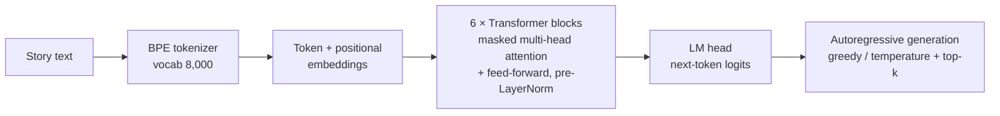

# Transformer from Scratch

[](https://huggingface.co/spaces/Skywalker67/transformer-from-scratch)
[](https://www.python.org/)
[](https://pytorch.org/)
[](https://github.com/tanishq-2004/transformer-from-scratch)

A decoder-only GPT-style Transformer built in PyTorch **from scratch** — no
`nn.Transformer`, no Hugging Face model, no Trainer. It learns to write
TinyStories-style children's stories, one token at a time.

**👉 Try it live:** https://huggingface.co/spaces/Skywalker67/transformer-from-scratch

## At a glance

| | |
|---|---|
| Architecture | Decoder-only Transformer (GPT-style), built from scratch |
| Parameters | **13,792,128** |
| Layers / heads / hidden | 6 layers, 6 heads, 384 hidden, context 256 |
| Tokenizer | BPE, trained on TinyStories, vocab 8,000 |
| Dataset | TinyStories — 200,000-story subset (full split: 2,119,719 train / 21,990 val) |
| Training | 8,000 steps, ~101 min on a Colab T4 GPU |
| Final train loss | **1.7893** |
| Final val loss | **1.8295** |
| Final val perplexity | **6.23** |

## How it works



Everything in the diagram above is hand-coded in `src/model.py` — scaled
dot-product attention, causal masking, multi-head attention, the feed-forward
network, residual connections and LayerNorm. The only things taken from
libraries are PyTorch autograd and the optimizer.

## What's built from scratch

- BPE tokenization (trained on TinyStories, vocab 8,000)
- Token embeddings + positional embeddings (learned or sinusoidal)
- Scaled dot-product attention, coded by hand
- Multi-head self-attention
- Causal masking
- Feed-forward networks, residual connections, pre-LayerNorm
- Decoder-only Transformer stack
- Cross-entropy loss and backpropagation (PyTorch autograd)
- Training on a real text corpus (TinyStories)
- Autoregressive text generation with KV cache, greedy + temperature / top-k

## Sample generations

All samples below are real outputs from the final checkpoint
(`ckpt_step_8000.pt`), not cherry-picked by hand — they are the first outputs
of the runs that produced them.

**Prompt:** `Once upon a time` — temperature 0.8, top-k 50

> there was a little girl named Lily. She loved to play with her toys all day
> long. One day, her mom surprised her with the big, pretty dress...

**Prompt:** `The little girl` — temperature 0.8, top-k 50

> was playing in the park when she heard a loud noise. She looked up and saw
> a big monster...

**Prompt:** `Once upon a time` — greedy decoding

> there was a little girl named Lily. She loved to play outside in the sun.
> One day, she saw a big, scary dog...

## Quickstart

```bash
git clone https://github.com/tanishq-2004/transformer-from-scratch.git
cd transformer-from-scratch
python -m venv .venv && source .venv/bin/activate
pip install -r requirements.txt
```

**Smoke test** (CPU, ~1 minute, 2 layers, Tiny Shakespeare, 50 steps):

```bash
python -m src.train --config configs/smoke.yaml
```

**Full run** (see `notebooks/kaggle_train.ipynb` for the Colab T4 run):

```bash
python -m src.train --config configs/small.yaml
# Resume from a checkpoint:
python -m src.train --config configs/small.yaml --resume checkpoints/ckpt_step_1000.pt
```

**Generate text:**

```bash
python -m src.generate --checkpoint checkpoints/ckpt_step_8000.pt \
  --tokenizer checkpoints/tokenizer.json \
  --prompt "Once upon a time" --max_new_tokens 50 --temperature 0.8 --top_k 50
```

**Evaluate:**

```bash
python -m src.evaluate --checkpoint checkpoints/ckpt_step_8000.pt \
  --tokenizer checkpoints/tokenizer.json --config configs/small.yaml
```

**Serve the API** (FastAPI, CPU):

```bash
uvicorn app.main:app --host 0.0.0.0 --port 8000
# GET /health, POST /generate {"prompt": "...", "max_new_tokens": 50}
docker build -t transformer-from-scratch .
docker run -p 8000:8000 transformer-from-scratch
```

**Try the Gradio demo locally:**

```bash
python app.py
```

> The 160 MB final checkpoint (`ckpt_step_8000.pt`) is not in this repo —
> GitHub blocks files over 100 MB. The live demo loads it from Hugging Face,
> and it is also backed up in Google Drive. The repo ships a
> `checkpoints/.gitkeep` placeholder instead.

## Project structure

```
transformer-from-scratch/
├── src/
│   ├── model.py        # Transformer, attention, generation (from scratch)
│   ├── tokenizer.py    # BPE training / loading
│   ├── data.py         # TinyStories loading, token blocks
│   ├── train.py        # Training loop, cosine schedule, checkpoints
│   ├── generate.py     # Text generation CLI
│   └── evaluate.py     # Loss / perplexity evaluation
├── app/
│   └── main.py         # FastAPI server (/health, /generate)
├── app.py              # Gradio demo (the live Hugging Face Space)
├── configs/
│   ├── small.yaml      # Full run: 6 layers, 6 heads, 384 hidden
│   └── smoke.yaml      # CPU smoke test: 2 layers, 50 steps
├── notebooks/
│   └── kaggle_train.ipynb   # Colab / Kaggle training notebook
├── tests_check.py      # 10 unit checks (all passing)
├── Dockerfile
└── experiments.md      # Ablation plan and results
```

## Results

All numbers below are from real runs — nothing here is an estimate or a guess.

**Full run** — Colab T4 GPU, 200,000-story TinyStories subset, 8,000 steps:

| Step | Train loss | Val loss | Val perplexity |
|---:|---:|---:|---:|
| 0 | 9.0384 | 9.0383 | 8419.33 |
| 6500 | — | — | 6.46 |
| 7999 | **1.7893** | **1.8295** | **6.23** |

- Training time: 6,071 s (~101 min), ~1.42 steps/sec steady
- Model: 6 layers, 6 heads, 384 hidden, context 256, 13,792,128 params
- Checkpoints: `ckpt_step_1000.pt`–`ckpt_step_8000.pt` (160 MB each) +
  `tokenizer.json`, backed up in Google Drive

**Smoke test** — CPU, Tiny Shakespeare, 2-layer, 538,240 params, 50 steps, 10 s:

| Step | Train loss | Val loss | Val perplexity |
|---:|---:|---:|---:|
| 0 | 6.9270 | 6.9208 | 1013.14 |
| 49 | 5.6711 | 5.6322 | 279.28 |

Unit checks: 10/10 passed. FastAPI `/health` and `/generate` verified HTTP 200
against the smoke checkpoint. See `logs/smoke_test_log.txt`.

## Experiments

See [`experiments.md`](experiments.md). Ablations are run as small controlled
runs on a 50k-story subset (same seed, LR and batch; change one variable at a
time), then the best config is retrained on the full 200k-story run. Planned
ablations: single-head vs multi-head attention, learned vs sinusoidal
positional embeddings, different depths and context lengths, temperature and
top-k sampling, and perplexity across configurations.

## Links

- **Live demo:** https://huggingface.co/spaces/Skywalker67/transformer-from-scratch
- **Dataset:** [roneneldan/TinyStories](https://huggingface.co/datasets/roneneldan/TinyStories) on Hugging Face
